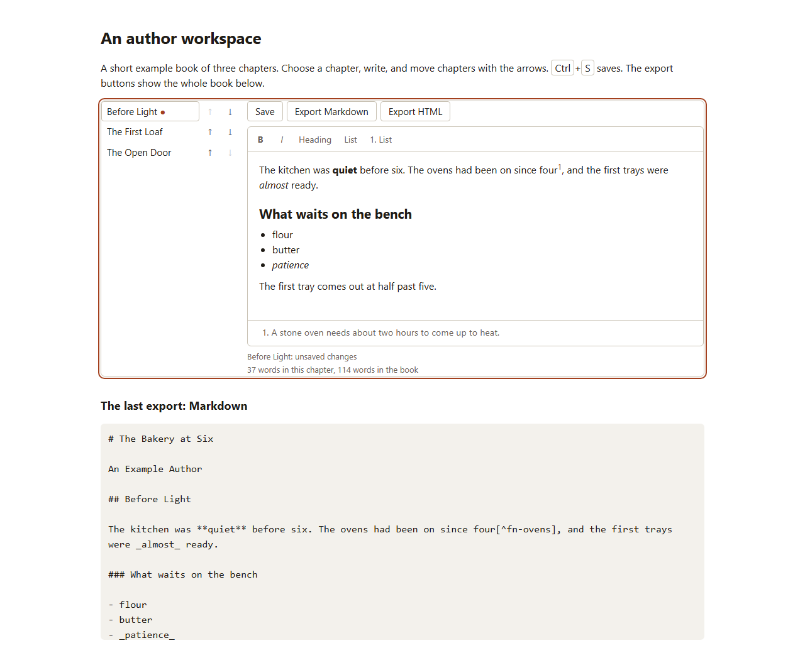

# Author workspace

An author opens a book, writes in a chapter, moves chapters, reads the word count, and exports the whole book.

| | |
|---|---|
| Status | Merged 2026-11-25 |
| Area | The author audience: the second acceptance script |
| Delivered in | [Pull request 14](https://github.com/Dev-of-Codes-LLC/open-editor/pull/14), which reached `main` through [pull request 18](https://github.com/Dev-of-Codes-LLC/open-editor/pull/18) |
| Decisions | [0008 author workspace](../decisions/0008-author-workspace.md), [0007 manuscript schema](../decisions/0007-manuscript-schema.md) |
| Related | [Manuscript schema](manuscript-schema.md), [Developer workspace](developer-workspace.md), [the plan](https://devofcodes.com/open-editor.html) |

## At a glance

- `createBookWorkspace({ mount, files })` puts a chapter list, a chapter editor, a word count and export buttons on a page.
- The book is a manifest and one file for each chapter, in a file store that the host owns.
- The author writes paragraphs, headings, bold, italic, links and lists. Images and footnotes show and are kept.
- Arrows move a chapter. The chapter keeps its id.
- Save writes only what changed. Export gives the whole book as Markdown or HTML.
- A browser test plays an author through the whole script in Chromium, Firefox and WebKit.

## Why it exists

The plan asks for two acceptance scripts: one for a developer and one for an author who edits and exports a chaptered manuscript. This is the author one, cut down to one person. It is also the first real use of the manuscript format.

## How it works

The host page makes a file store that holds the book and hands it to the workspace.

1. Run `pnpm install`, `pnpm build` and `pnpm quickstart`. Open `http://127.0.0.1:4173/examples/author/`.
2. Choose a chapter. It opens with its headings, its image and its footnotes.
3. Write. The line under the editor says "unsaved changes" and the word count follows.
4. Press an arrow next to a chapter to move it up or down.
5. Press Ctrl+S or the Save button.
6. Press Export Markdown or Export HTML.



A narrated video of these steps, 69 seconds: [author-workspace.mp4](author-workspace/author-workspace.mp4), with [captions](author-workspace/author-workspace.srt).

The host code:

```js
import { createBookWorkspace, memoryFiles } from "./packages/editor/dist/standalone/book-workspace.js";

const workspace = createBookWorkspace({
  mount: document.getElementById("workspace"),
  files: memoryFiles({ "book.json": bookText, "chapters/ch-one.json": chapterText }),
});
await workspace.ready;
```

### The workspace

| Member | Does |
| --- | --- |
| `ready` | A promise that resolves when the book is read. It rejects, with the reason, when the book is not valid |
| `open(id)` | Shows a chapter |
| `save()` | Writes every changed chapter, then the manifest when the order changed |
| `moveChapter(id, to)` | Moves a chapter in the reading order. Not written until save |
| `wordCount()` | `{ book, chapter }`: words in the body text, with unsaved text counted |
| `exportBook("markdown" \| "html")` | Resolves to `{ text, lost }` for the whole book |
| `book()`, `current()`, `isDirty()` | The manifest now, the chapter on screen, and whether anything is unsaved |
| `on("open" \| "change" \| "save" \| "move", handler)` | Calls the handler with the chapter's id |
| `destroy()` | Removes the workspace and every editor in it |

Options: `manifest` (the manifest's path, default `book.json`), `imageUrl` (turns an image's path in the book into an address the page can load), and `onExport` (receives an export from a button; by default the browser saves a file).

### The chapter editor alone

`createChapterEditor({ mount, chapter })` is the editor without the workspace. `getChapter()` returns a valid chapter document. Commands: `bold`, `italic`, `heading` with `{ level }`, `bulletList`, `orderedList`, `undo`, `redo`, `focus`.

### What counts as a word

A word is a run between spaces that holds a letter or a digit, so "don't" and "over-proved" are one word each. The body counts: paragraphs, headings and list items. Footnotes, captions and chapter titles do not.

## What it guarantees

Each promise has a test that runs on every change. The browser tests run in three browsers.

- **Nothing is written before a save.**
- **A save writes only what changed.** In the script that is one chapter and the manifest. Two chapters that were opened and not edited stay byte for byte the same.
- **A moved chapter keeps its id**, and its file. Only the order in the manifest changes.
- **What the editor writes is valid.** Every saved chapter passes the validator, after a split paragraph and after a deleted footnote call too.
- **A chapter comes back from the editor exactly as it went in** when nothing was edited.
- **A deleted footnote call takes its note with it, and undo brings both back.**
- **Export holds the whole book in the current order**, with nothing left out. The HTML has no script, and its footnote links point at notes that exist.
- **Text cannot add markup to an export.** A `<script>` in a chapter comes out as text.
- **A book that is not valid is not opened**, and the page says why.
- **A refused write leaves the book unsaved and says why.**
- **The arrows work from the keyboard**, and the focus stays on the chapter that moved.

## What it does not do

- **No adding or editing of footnotes and images.** They show, and they are kept.
- **No new chapter, rename or remove.**
- **No tables, comments, named versions or tracked changes.**
- **No DOCX or EPUB.** Export is Markdown and HTML, and neither is read back.
- **No search across the book.**
- **No warning when a tab closes with unsaved changes.**

> **Limitation:** After a click on a chapter's name, the caret arrives in the chapter one frame later. Keys pressed inside that frame land at the start of the chapter. A person is slower than a frame, and the test waits for the focus. It is open to fix.

## Verification

| Check | Outcome |
|---|---|
| The author script, in Chromium, Firefox and WebKit | pass |
| Nine more workspace tests, in the same three browsers | pass |
| Unit tests for word count, both exports and the converter | pass |
| An author who is not the developer doing the script by hand | not checked |
| Screen readers, phones, real Safari | not checked |

> **Not verified:** Retention is not measured for the workspace. No book longer than the three-chapter example was opened, and the workspace reads every chapter at start.

Run `pnpm test:browser` for the tests and `pnpm measure` for the file sizes on your machine. Measured on 2026-11-25: `book-workspace.js` is 142.7 kB gzip, 8.5 kB more than the small prose field.

## Technical appendix

| What | Where |
| --- | --- |
| Workspace | `packages/editor/src/workspace/book.ts`, `book.css` |
| Chapter editor | `packages/editor/src/manuscript/chapter.ts` |
| Engine JSON to chapter, with the repairs | `packages/editor/src/manuscript/editor-json.ts` |
| Word count | `packages/editor/src/book/words.ts` |
| Export to Markdown and HTML | `packages/editor/src/book/export.ts` |
| The author script | `tests/browser/author.spec.ts` |
| The page the script drives | `tests/browser/author-workspace.html` |
| Example page and example book | `examples/author/index.html`, `examples/book/` |
| Imports | `@devofcodes/editor/book-workspace`, `@devofcodes/editor/chapter`, `@devofcodes/editor/book`, `@devofcodes/editor/book-workspace.css` |
