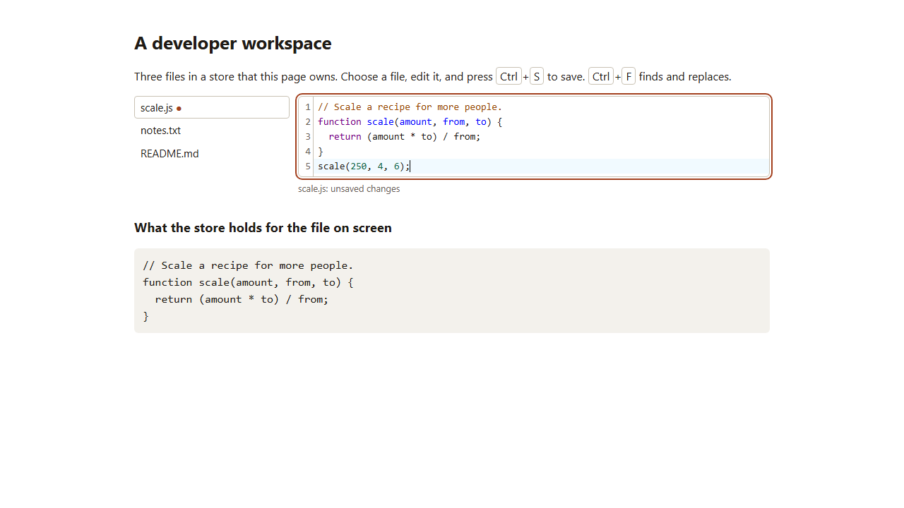

# Developer workspace

A developer opens the files of a small project, edits them, and saves them through a file store that the host page owns.

| | |
|---|---|
| Status | Merged 2026-11-25 |
| Area | The developer audience: the first acceptance script |
| Delivered in | [Pull request 12](https://github.com/Dev-of-Codes-LLC/open-editor/pull/12) |
| Decisions | [0006 file store](../decisions/0006-file-store.md) |
| Related | [Two profiles behind one createEditor](two-profiles.md), [the plan](https://devofcodes.com/open-editor.html) |

## At a glance

- `createCodeWorkspace({ mount, files })` puts a file list and a code editor on a page.
- The host owns the files. It hands in a store with three calls: `list`, `read` and `write`.
- Each open file keeps its unsaved text and its undo history while another file is on screen.
- Ctrl+S, or Cmd+S on a Mac, saves the file on screen. A failed save says why and keeps the file marked unsaved.
- A browser test plays a developer through the whole script in Chromium, Firefox and WebKit.

## Why it exists

The plan asks for two acceptance scripts in its first month: one for a developer and one for an author. This is the developer one, cut down to one person. It answers one question: can a developer do real work in a file, save it, and trust what was saved?

## How it works

The host page makes a store, hands it to the workspace, and the developer does the rest.

1. Run `pnpm install`, `pnpm build` and `pnpm quickstart`. Open `http://127.0.0.1:4173/examples/workspace/`.
2. Choose a file in the list. It opens in a code editor, and the line under the editor says "saved".
3. Type. The line says "unsaved changes", and the file's name gets a dot.
4. Press Ctrl+F to find and replace.
5. Press Ctrl+S. The store receives the text, and the line says "saved" again.



A narrated video of these steps, 65 seconds: [developer-workspace.mp4](developer-workspace/developer-workspace.mp4), with [captions](developer-workspace/developer-workspace.srt).

The host code:

```js
import { createCodeWorkspace, memoryFiles } from "./packages/editor/dist/standalone/code-workspace.js";

const files = memoryFiles({ "scale.js": "let a = 1;\n" });
const workspace = createCodeWorkspace({ mount: document.getElementById("workspace"), files });
workspace.on("save", (path) => console.log("saved", path));
```

### The file store

A host writes its own store for a server, a folder or browser storage.

| Call | Does |
| --- | --- |
| `list()` | Resolves to the paths, in the order to show them |
| `read(path)` | Resolves to the whole text of one file |
| `write(path, text)` | Replaces the whole file. Resolves when the text is safely written |

A call that fails rejects with an `Error`. The workspace shows its message.

### The workspace

| Member | Does |
| --- | --- |
| `ready` | A promise that resolves when the file list is on the page |
| `open(path)` | Shows a file, reading it the first time |
| `save(path)` | Writes one file through the store. With no path, the file on screen |
| `files()`, `current()`, `isDirty(path)` | The listed paths, the file on screen, and whether a file has unsaved changes |
| `on("open" \| "change" \| "save", handler)` | Calls the handler with the file's path |
| `destroy()` | Removes the workspace and every editor in it |

The code profile also has a new command: `execute("replaceAll", { query, replacement })`.

## What it guarantees

Each promise has a browser test that runs on every change, in three browsers.

- **Nothing is written before a save.** Opening, editing and switching files leave the store as it was.
- **A save writes one file.** The other open file keeps its unsaved changes and is not written.
- **Line endings and the final newline are kept.** A file with Windows line endings is written back with them.
- **An untouched file stays byte for byte the same.**
- **Saved work is there after a reload**, when the host's store keeps it.
- **Unsaved text and undo history survive a switch** to another file and back.
- **A refused write changes nothing.** The file stays unsaved, the status line gives the store's message, and `save()` rejects.
- **`destroy` removes every editor.**

## What it does not do

- **No new file, rename, delete or close.** The script does not need them.
- **No warning when a tab closes with unsaved changes.** That is the host's to add.
- **No check for a file that changed elsewhere.** Two tabs can overwrite each other.
- **No completion, diagnostics or language server.** Syntax colours cover JavaScript and TypeScript, picked from the file's extension.
- **No search across files.** Find and replace works in the file on screen.
- **No large-file path.** A file is read and written whole.

> **Limitation:** In WebKit, Escape does not close the search panel after a click on one of its buttons, because a clicked button does not take focus there. The panel's close button works. The script uses the close button for that reason.

## Verification

| Check | Outcome |
|---|---|
| The developer script, in Chromium, Firefox and WebKit | pass |
| Seven more workspace tests, in the same three browsers | pass |
| Unit tests for the file store, in Node | pass |
| A developer who is not the author doing the script by hand | not checked |
| Screen readers, phones, real Safari | not checked |

> **Not verified:** Retention is not measured for the workspace. The 50-cycle test covers the two profiles only.

Run `pnpm test:browser` for the tests and `pnpm measure` for the file sizes on your machine. Measured on 2026-11-25: the workspace file is 163.1 kB gzip, 1.4 kB more than the code profile alone.

## Technical appendix

| What | Where |
| --- | --- |
| File store contract and `memoryFiles` | `packages/editor/src/files.ts` |
| Workspace | `packages/editor/src/workspace/code.ts`, `style.css` |
| `replaceAll` command | `packages/editor/src/code/index.ts` |
| The developer script | `tests/browser/developer.spec.ts` |
| The page the script drives, with its own store | `tests/browser/developer-workspace.html` |
| Example page | `examples/workspace/index.html` |
| Imports | `@devofcodes/editor/code-workspace`, `@devofcodes/editor/files`, `@devofcodes/editor/code-workspace.css` |
