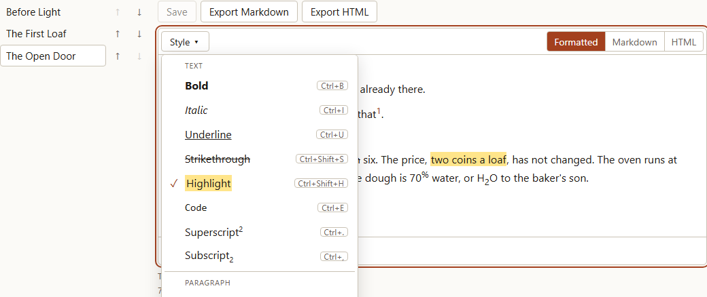
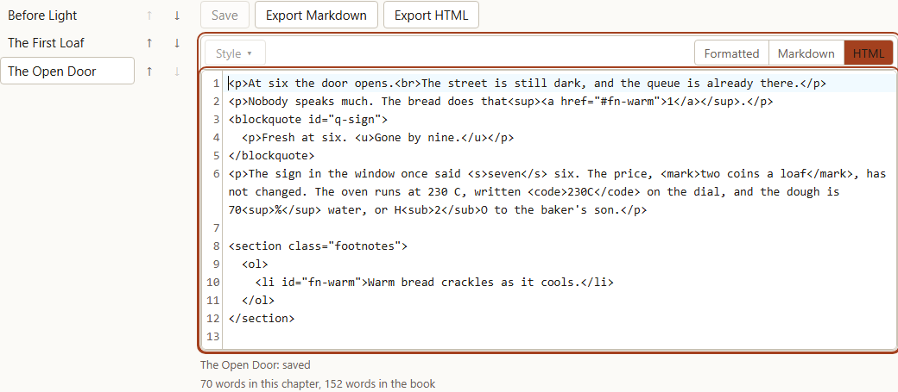

# Style menu and three views

An author sets every style from one menu or its shortcuts, and can edit the same chapter formatted, as Markdown or as HTML.

| | |
|---|---|
| Status | In review as of 2026-11-25 |
| Area | The chapter editor of the author workspace |
| Delivered in | [Pull request 20](https://github.com/Dev-of-Codes-LLC/open-editor/pull/20) |
| Decisions | [0009 style menu](../decisions/0009-style-menu.md), [0010 three views](../decisions/0010-three-views.md) |
| Related | [Author workspace](author-workspace.md), [Manuscript schema](manuscript-schema.md) |

## At a glance

- One **Style** button opens a menu of 18 entries, each with its keyboard shortcut for the platform you are on.
- Text styles: bold, italic, underline, strikethrough, highlight, code, superscript and subscript.
- **Copy formatting** and **Paste formatting** move the text styles of one piece of text onto another.
- A switch shows the chapter **Formatted**, as **Markdown** or as **HTML**. Typing in any view changes the same chapter.
- The page at the root of the local server shows all of it, with a chapter already open.

## Why it exists

The chapter editor had five buttons and one view. An author needs the common styles within reach and wants to learn their keys. Some authors think in Markdown, and some need to see or fix the HTML. All three are the same chapter, so all three should edit it.

## How it works

Run `pnpm install`, `pnpm build` and `pnpm quickstart`, and open `http://127.0.0.1:4173/`. A chapter is open under "Write a book".

### The Style menu

1. Press **Style**, above the text.
2. Choose a text style. It gets a tick, and the menu stays open for the next one.
3. Choose a paragraph style. The menu closes and the caret is back in the text.

From the keyboard: the arrow keys move, Home and End jump, a letter jumps to the next entry that starts with it, Enter chooses and Escape closes.



| Style | Windows and Linux | Mac |
| --- | --- | --- |
| Bold, italic, underline | Ctrl+B, Ctrl+I, Ctrl+U | ⌘B, ⌘I, ⌘U |
| Strikethrough, highlight | Ctrl+Shift+S, Ctrl+Shift+H | ⇧⌘S, ⇧⌘H |
| Code | Ctrl+E | ⌘E |
| Superscript, subscript | Ctrl+. and Ctrl+, | ⌘. and ⌘, |
| Normal text, heading 1 to 3 | Ctrl+Alt+0 to 3 | ⌥⌘0 to 3 |
| Bullet list, numbered list | Ctrl+Shift+8, Ctrl+Shift+7 | ⇧⌘8, ⇧⌘7 |
| Block quote | Ctrl+Shift+B | ⇧⌘B |
| Copy and paste formatting | Ctrl+Alt+C, Ctrl+Alt+V | ⌥⌘C, ⌥⌘V |
| Clear formatting | Ctrl+\ | ⌘\ |

### Copy and paste formatting

1. Put the caret in styled text, or select it. Press Ctrl+Alt+C.
2. Select other text. Press Ctrl+Alt+V.

The target gets exactly the copied text styles. With nothing selected, the next typing gets them. It works from one chapter to another.

### The three views

The switch is on the right, above the text: **Formatted**, **Markdown**, **HTML**.

1. Choose **Markdown**. The chapter shows as Markdown source, with line numbers.
2. Type. For example, add a line `## Later` and a line `The shelves are **empty**.`
3. Choose **Formatted**. The heading and the bold word are there.



A narrated video of all three, 60 seconds: [style-menu-and-views.mp4](style-menu-and-views/style-menu-and-views.mp4), with [captions](style-menu-and-views/style-menu-and-views.srt).

For a host page:

```js
const editor = createChapterEditor({ mount, chapter, view: "markdown" });
editor.setView("html");
editor.view();          // "html"
editor.getChapter();    // the chapter, with anything typed in the source read back
```

## What it guarantees

Each promise has a test that runs on every change. The browser tests run in three browsers.

- **Every style has a shortcut that sets it**, and what the editor then writes is a valid chapter.
- **The menu shows what is set** where the caret is.
- **Paste formatting gives exactly the copied text styles**, and one undo takes it back.
- **Each example chapter survives a trip through the Markdown view and through the HTML view unchanged**: text, styles, footnotes, images and block ids.
- **Save and Export never miss typing** in a source view, even with no pause.
- **Nothing typed into a source view is run or fetched.** A `<script>`, an `onclick`, an `<iframe>` and a picture from the web are dropped.
- **The strikethrough shortcut does not save the book.**
- **The menu and the view switch work from the keyboard alone.**

## What it does not do

- **No link, colour, font, size or alignment** in the Style menu.
- **No syntax colours** in the source views.
- **The small prose field of the quickstart keeps its four buttons.** Its Markdown format cannot hold the new styles.
- **Copy formatting does not carry a heading, a list or a quote.** Text styles only.
- **Your own spacing in the Markdown is not kept.** A switch of view writes the source again in one layout.
- **Markdown the format cannot hold is flattened with no message**: a table, a code block, a list inside a list.

> **Limitation:** The author workspace file grew from 143 kB to 357 kB compressed. It now carries the code editor and the Markdown parser, for a feature some authors will never open. Loading the source views on first use would win most of that back.

## When something goes wrong

| Situation | What you see | What to do |
| --- | --- | --- |
| A shortcut does nothing | The browser took the key first. Ctrl+Shift+B shows the bookmarks bar in Chrome and Edge; ⌘, opens settings on a Mac | Use the Style menu |
| A picture typed in the HTML view is gone | Its address was a web address | Use the path of a file in the book, such as `images/loaf.svg` |
| A block lost its id after a Markdown edit | Its text changed, and Markdown has no place for an id | Edit ids in the HTML view |
| Paste formatting is grey | Nothing has been copied on this page yet | Copy formatting first |

## Verification

| Check | Outcome |
|---|---|
| Style menu and shortcut tests, in three browsers | pass |
| Copy and paste formatting tests, in three browsers | pass |
| View tests, round trips included, in three browsers | pass |
| Unit tests for both source writers and the Markdown reader | pass |
| The Mac key labels, on a Mac | not checked |
| Shortcuts against each browser's own keys | not checked |
| A keyboard where Ctrl+Alt is AltGr | not checked |
| Screen readers | not checked |

Measured on 2026-11-25 with `pnpm measure`: `book-workspace.js` is 357.2 kB gzip.

## Technical appendix

| What | Where |
| --- | --- |
| The list of styles and their keys | `STYLES` in `packages/editor/src/manuscript/chapter.ts` |
| The menu | `packages/editor/src/manuscript/style-menu.ts` |
| Copy and paste formatting | `copyFormatting`, `pasteFormatting` in `chapter.ts` |
| Writing a chapter as Markdown and HTML source | `chapterToMarkdownSource`, `chapterToHtmlSource` in `packages/editor/src/book/export.ts` |
| Reading source back | `packages/editor/src/manuscript/source.ts`, and `readSource` in `chapter.ts` |
| Block ids after Markdown | `keepBlockIds` in `export.ts` |
| New marks and the block quote | `packages/editor/src/book/types.ts`, `validate.ts`, `schema/chapter.schema.json` |
| The page at the root | `examples/index.html` |
| Tests | `tests/browser/style-menu.spec.ts`, `views.spec.ts`, `showcase.spec.ts`; `packages/editor/test/book-styles.test.ts`, `book-source.test.ts` |
