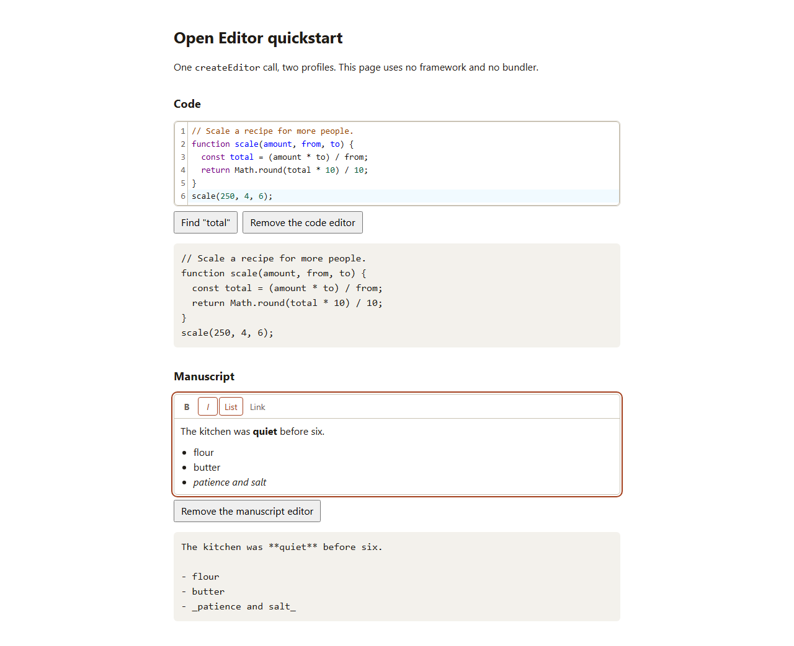

# Two profiles behind one createEditor

One call puts a code editor or a manuscript editor on any web page, with the same five methods for both.

| | |
|---|---|
| Status | In review as of 2026-11-25 |
| Area | The SDK's smallest layer: one editing surface for each audience |
| Delivered in | [Pull request 1](https://github.com/Dev-of-Codes-LLC/open-editor/pull/1) |
| Decisions | [0001 engines](../decisions/0001-engines.md), [0002 entry points](../decisions/0002-one-package-three-entry-points.md), [0003 documents](../decisions/0003-documents-are-strings.md), [0004 retention](../decisions/0004-retention.md), [0005 tooling](../decisions/0005-tooling.md) |
| Related | [The plan](https://devofcodes.com/open-editor.html) |

## At a glance

- `createEditor({ mount, profile })` builds a `"code"` editor on CodeMirror 6 or a `"manuscript"` editor on Tiptap's open-source packages and ProseMirror.
- Both give the host the same methods: `on("change")`, `execute`, `getDocument`, `setDocument` and `destroy`.
- A page that needs one profile loads one file with one engine in it.
- It works on a page with no framework and no bundler.
- It is a first slice. There are no chapters, no export, no collaboration and no storage yet.

## Why it exists

The plan gives software developers and book authors equal standing from the first release. Before this, only the manuscript side existed, as the editor field in Tastebuds. This slice adds the code side behind the same API, so both audiences exist in the smallest layer.

## How it works

A host page makes one call for each editor and saves the string that `"change"` hands it.

1. Run `pnpm install`, `pnpm build` and `pnpm quickstart`. Open `http://127.0.0.1:4173/`.
2. The page shows a code editor and a manuscript editor. Under each is the document the page receives.
3. Type in either editor. The document under it follows every key.
4. Press a "Remove" button. The page calls `destroy()` and the editor is gone.



The whole host code for one editor:

```js
import { createEditor } from "./packages/editor/dist/standalone/editor.js";

const editor = createEditor({
  mount: document.getElementById("editor"),
  profile: "code",
  language: "javascript",
  document: "let a = 1;",
});
editor.on("change", (document) => save(document));
```

### Options

| Option | Profile | Meaning |
| --- | --- | --- |
| `mount` | both | The element to build the editor in. Required. |
| `profile` | both | `"code"` or `"manuscript"`. Required in the shared file. |
| `document` | both | The starting document, a string. |
| `label` | both | The name a screen reader says for the editor. |
| `language` | code | `"plain"` (the default), `"javascript"` or `"typescript"`. |
| `lineNumbers` | code | `false` hides them. |
| `placeholder` | manuscript | Grey text while the editor is empty. |
| `toolbar` | manuscript | `false` hides the row of buttons. |

### Commands

`execute(command, args)` returns `false` when the command could not apply. An unknown command is an error.

| Profile | Commands |
| --- | --- |
| code | `undo`, `redo`, `focus`, `find` with `{ query }` |
| manuscript | `bold`, `italic`, `bulletList`, `link` with `{ href }`, `unlink`, `undo`, `redo`, `focus` |

### Files

| File in `packages/editor/dist/standalone/` | Holds | Size, gzip |
| --- | --- | ---: |
| `code.js` | The code profile and CodeMirror | 161.7 kB |
| `manuscript.js` and `manuscript.css` | The manuscript profile, Tiptap and ProseMirror | 134.9 kB |
| `editor.js` and `editor.css` | Both | 295.6 kB |

A project with a bundler imports `@devofcodes/editor/code`, `@devofcodes/editor/manuscript` or `@devofcodes/editor`. The package is not on npm yet.

## What it guarantees

Each promise has a test that runs on every change.

- **Typing reaches the host.** Real key presses change the document and fire `"change"`, in Chromium, Firefox and WebKit.
- **`setDocument` is quiet.** It replaces the document and does not fire `"change"`.
- **`destroy` empties the mount.** A second call does nothing, and the handle's commands return `false`.
- **Code keeps its line endings.** A file with Windows line endings comes back with them.
- **Manuscript links are http or https only.** A `javascript:` address is refused.
- **One profile, one engine.** `code.js` holds no ProseMirror package and `manuscript.js` holds no CodeMirror package. The build reads this from the bundler.
- **The package imports with no browser.** The unit tests run in Node.
- **Nothing piles up.** After 50 mount, edit and dispose cycles in Chromium, DOM nodes and event listeners are back to where they started. See the limitation below for the one object that stays.

> **Limitation:** One destroyed manuscript editor stays in memory until the next manuscript editor takes its place. It is one editor, not one for each mount. The cause is a module-level variable in ProseMirror's history package. [Decision 0004](../decisions/0004-retention.md) has the chain of references.

## What it does not do

- **No chapters, outline, footnotes, images or export.** The manuscript profile is one prose surface with paragraphs, bold, italic, links and bullet lists.
- **No completion, diagnostics, folding or language server.** The code profile has syntax colours for JavaScript and TypeScript, search, undo and several cursors.
- **No extensions and no storage adapter.** Both options exist in the API and both raise an error when used.
- **No collaboration, comments or versions.**
- **No performance target is met.** Every target in the plan's section 8 is a proposal. This slice measured file sizes and retention only.
- **Not on npm.** A host copies the built files or uses the workspace.

## Verification

| Check | Outcome |
|---|---|
| Unit tests in Node: 18 | pass |
| Browser tests in Chromium, Firefox and WebKit: 48 | pass |
| Retention, 50 cycles for each profile, Chromium | pass |
| Screen readers, phones, on-screen keyboards | not checked |
| Typing latency, large documents | not checked |

> **Not verified:** No person has followed the quickstart against the plan's 15-minute target. The manuscript heap still grows by about 1.1 kB for each cycle between 200 and 400 cycles, and the cause is not found.

Measured on 2026-11-25 on an AMD Ryzen 9 9900X with 94 GB of memory, Windows 11, Chromium 159. Run `pnpm measure` for the figures on your machine.

## Technical appendix

| What | Where |
| --- | --- |
| Shared contract | `packages/editor/src/contract.ts` |
| Code profile | `packages/editor/src/code/index.ts` |
| Manuscript profile | `packages/editor/src/manuscript/index.ts` |
| Stored manuscript format | `packages/editor/src/manuscript/markdown.ts` |
| Build, two outputs | `packages/editor/build.mjs` |
| Quickstart page | `examples/quickstart/index.html` |
| Browser tests | `tests/browser/profiles.spec.ts`, `tests/browser/retention.spec.ts` |
| Retainer chains from a heap snapshot | `tests/browser/retainers.ts` |
| Measurements | `scripts/measure.mjs` |
| Licence list | `scripts/licenses.mjs`, `THIRD-PARTY.md` |

The look follows CSS variables that a host sets on any element around the editor: `--oe-ink`, `--oe-muted`, `--oe-line`, `--oe-surface`, `--oe-accent`, `--oe-font` and `--oe-code-font`.
